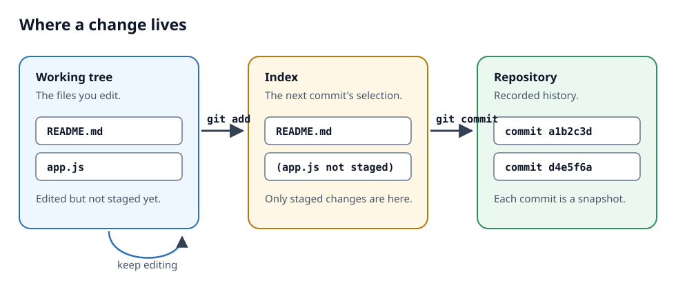

A change moves from the working tree into the index when you stage it, and from the index into the repository when you commit it. Editing the working tree again does not change what is already staged.
